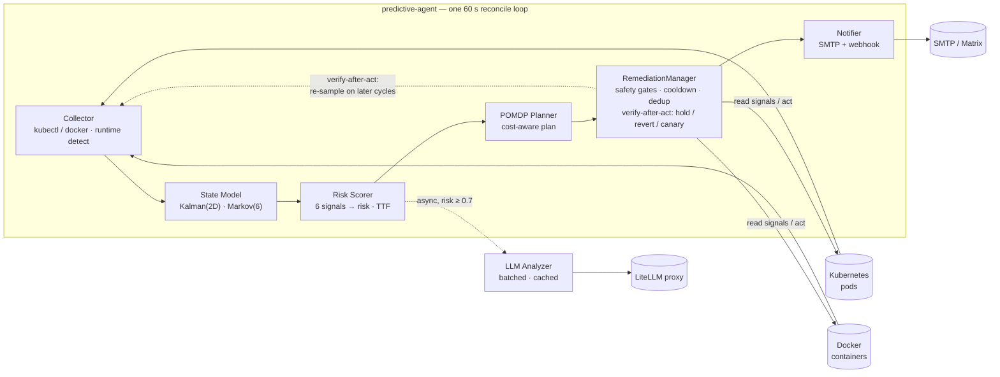

# openDesk Predictive Agent v4.0.8

**Predictive health monitor for Kubernetes and Docker — detects failure trends, predicts crashes, remediates before they happen.**

> **Architecture documentation:** see [docs/arc42.md](docs/arc42.md) (arc42 template, 12 sections). ADRs in [docs/adr](docs/adr). Operator runbook: [docs/OPERATOR_RUNBOOK.md](docs/OPERATOR_RUNBOOK.md).

## Overview

Predictive-agent shifts monitoring from reactive (detect crash → analyze) to predictive (detect trends → predict failure → remediate). Each 60-second reconcile cycle it collects pod/container metrics, estimates resource trends with Kalman filters, scores failure risk from six signals, and — when risk crosses the threshold — plans and executes remediation through a POMDP-style decision layer with LLM-supported analysis.

### Key Features

- **Kalman filter** (2D: level + velocity) for memory/CPU trend estimation with confidence intervals
- **Markov chain** (6 states) for pod state transition prediction
- **Bayesian risk scoring** combining 6 signals (memory %, trend, CPU %, restarts, logs, node pressure)
- **POMDP decision layer** — cost-aware planning (action cost vs. failure risk) closes the predict → plan → remediate loop
- **Autonomous remediation** with safety checks, cooldowns, dry-run mode, and an audit trail
- **Self-health alerting** — the agent emails its own failure modes (persistence errors, degraded-collector streaks), rate-limited per issue kind
- **LLM analysis** (async, batched, cached) with predictions, uncertainty, and time-to-failure
- **Dual runtime** — monitors Kubernetes pods (kubectl) or Docker containers (socket), auto-detected
- **Multiple LLM backends** — Ollama, Saia API, OpenAI-compatible
- **OPA policy gate (opt-in)** — Rego-based policy checks gate remediation in the reconcile loop (`OPA_ENABLED=true`, fail-open)
- **State persistence** — Kalman/Markov model and prediction history survive restarts

## Architecture



**The loop:** collect → estimate trends → score risk → (if risky) plan with the POMDP planner → execute remediation with safety checks → **verify-after-act** (hold / auto-revert / canary-widen on no improvement) → notify → persist state.

## Deployment

### Requirements

- Python 3.11+ (for running directly)
- Nix with flakes + a docker daemon (for the reproducible container image)
- A Kubernetes cluster with metrics-server (for K8s mode)
- kubectl configured (for K8s mode)
- PVC for persistence (optional but recommended)

> Full image build + run instructions (including **Docker-native mode** and
> local spin-up via `docker compose`) are in [docs/DEPLOY_NIX.md](docs/DEPLOY_NIX.md).

### Kubernetes

**Option A — Nix container image (recommended, reproducible)**

```bash
# Build + load the image into docker (see docs/DEPLOY_NIX.md for prereqs)
./scripts/build-nix-image.sh

# Run locally in Docker-native mode (dry-run)
docker compose up

# Deploy to Kubernetes (update image tag in k8s/deployment.yaml first)
kubectl apply -f k8s/namespace.yaml
kubectl apply -f k8s/rbac.yaml
kubectl apply -f k8s/pvc.yaml
kubectl apply -f k8s/configmap.yaml
kubectl apply -f k8s/service.yaml
kubectl apply -f k8s/deployment.yaml
kubectl apply -f k8s/servicemonitor.yaml
# or push to a registry and roll out with:
./deploy-updated-version.sh
```

**Option B — plain `docker build`**

```bash
docker build -t predictive-agent:v4.0 .
docker run --rm -v /var/run/docker.sock:/var/run/docker.sock:ro -e OPERATOR_RUNTIME=docker -e LLM_BACKEND=none predictive-agent:v4.0
```

**Option C — run the Python package directly**

```bash
pip install -e .
python3 -m predictive_agent.main
```

### Docker (standalone hosts)

Deployed via the `monitoring_agents` Ansible role (`monitoring_agents/` in this repo, playbook in ansible-private). The agent runs with the Docker socket mounted and monitors local containers:

```bash
ansible-playbook playbooks/monitoring-agents.yaml -l <host>
```

### Requirements

- Kubernetes: metrics-server for `kubectl top`; PVC for persistence (recommended)
- Docker: Docker socket mounted read-only
- Python 3.11+ (only for development; production runs as container)

## Configuration

### Environment Variables

```env
# Core
OPERATOR_NAME=opendesk-predictive-agent
OPERATOR_NAMESPACE=opendesk-predictive-agent
OPERATOR_VERSION=4.0.2
WATCH_NAMESPACES=opendesk,opendesk-edu,default,llm

# Runtime Detection (Docker vs Kubernetes)
# 'docker': monitor Docker containers via socket
# 'kubernetes': monitor Kubernetes pods via kubectl
# Default: auto-detected (docker if a socket is available)
OPERATOR_RUNTIME=docker

# Docker Mode Selectors (used when runtime is docker)
# If ALL are empty, ALL running containers are monitored.
# If ANY is set, a container must match ALL configured selectors.

# Label selectors: key=value,key2=value2 (container must have all)
OPERATOR_WATCH_LABELS=

# Docker Compose project names: myapp,webapp
OPERATOR_WATCH_COMPOSE_PROJECTS=

# Container name patterns with wildcards: web-*,api-*
OPERATOR_WATCH_NAMES=

# Kubernetes Mode Selector (used when runtime is kubernetes)
OPERATOR_WATCH_NAMESPACES=default

# LLM (choose one backend)
LLM_BACKEND=ollama  # ollama, saia, openai
OLLAMA_URL=http://ollama.llm.svc.cluster.local:11434
OLLAMA_MODEL=qwen3-30b-a3b:latest
SAIA_API_URL=https://api.saia.ai/v1
SAIA_API_KEY=your-key
OPENAI_API_URL=https://api.openai.com/v1
OPENAI_API_KEY=your-key

# Reconcile
RECONCILE_INTERVAL=60
MAX_PODS_PER_CYCLE=3

# Prediction
PREDICTION_ENABLED=true
PREDICTION_RISK_THRESHOLD=0.5
KALMAN_PROCESS_NOISE=1.0
KALMAN_MEASUREMENT_NOISE=100.0

# Persistence
STATE_MODEL_FILE=/var/lib/opendesk/state-model.json
PREDICTIONS_FILE=/var/lib/opendesk/predictions.json
HISTORY_FILE=/var/lib/opendesk/analysis-history.json

# Email alerting (uni HRZ relay: port 25, no auth; From must be a resolvable
# uni domain or the relay rejects with 550 5.1.8)
ALERT_EMAIL_TO=alerts@example.com
ALERT_EMAIL_FROM=alerts@example.com
SMTP_HOST=smtp.example.com
SMTP_PORT=25
SMTP_USE_TLS=true
```

### Selector Behavior

| Variable | Default | Behavior |
|----------|---------|----------|
| `OPERATOR_RUNTIME` | Auto-detected | `docker` if `DOCKER_SOCKET` env var or `/var/run/docker.sock` exists, else `kubernetes`. |
| `OPERATOR_WATCH_LABELS` | Empty (no filter) | Container must match ALL specified labels. |
| `OPERATOR_WATCH_COMPOSE_PROJECTS` | Empty (no filter) | Matches label `com.docker.compose.project`. |
| `OPERATOR_WATCH_NAMES` | Empty (no filter) | Shell-style wildcards (`*`, `?`), e.g. `web-*` matches `web-1`, `web-frontend`. |
| `OPERATOR_WATCH_NAMESPACES` | `default` | Kubernetes mode only: pods in these namespaces are monitored. |

**Selector logic (Docker mode):** if any selector is configured, a container must match ALL of them; if none are configured, all running containers are monitored.

## Endpoints

### Health & Metrics

| Endpoint | Description |
|----------|-------------|
| `GET /healthz` | Liveness probe |
| `GET /ready` | Readiness probe |
| `GET /metrics` | Prometheus metrics |
| `GET /status` | Full status JSON |

### Prediction & Analysis

| Endpoint | Description |
|----------|-------------|
| `GET /predictions` | All pods with risk > threshold |
| `GET /state` | Markov chain + per-pod states |
| `GET /history` | Analysis history |
| `GET /cache` | Analysis cache |
| `POST /reanalyze/{pod}` | Force re-analysis |
| `POST /remediate` | Trigger remediation for a pod |
| `GET /remediation-log` | Remediation audit trail (includes `lifecycle` per row) |
| `GET /remediation/state` | In-flight verify/hold/canary remediation state |
| `GET /notifications` | Recent remediation notifications |
| `GET /backtest` | Backtest predictions against history |

### Decision Layer (POMDP)

| Endpoint | Description |
|----------|-------------|
| `GET /plan?state=CRITICAL&horizon=3` | Preview a remediation plan (no execution) |
| `GET /world-model?state=…&action=…` | What-if simulator: per-step state distribution + failure probability |
| `GET /cost-model` | Current decision-theoretic costs (read-only) |
| `GET /decision-metrics` | Decision-layer metrics as JSON |
| `GET /calibration` | Prediction calibration + safety-guardrail status |
| `GET /benchmark` | 4-strategy decision benchmark over backtester scenarios |
| `GET /shadow` | Shadow-mode validation harness summary |
| `GET /review` · `POST /review` | Bounded-autonomy remediation reviews (approve/reject) |
| `POST /coordinate` | Multi-agent (Dec-POMDP) joint plan |

### Closed-Loop Remediation (verify-after-act)

After an action executes, the agent verifies it measurably improved the pod's
signals (`VERIFY_SETTLING_S` settling window, `VERIFY_MIN_SIGNALS` independent
signals). Failed verification puts the action **on hold** (`VERIFY_HOLD_S`) so
the same failing action is never re-fired blindly; repeated failures escalate
through the existing `remediation_exhausted` channel. Reversible actions
(`reversible=true`) are auto-reverted on failed verification; irreversible
ones require operator approval via `POST /review`. Canary-capable actions
(`canary_fraction > 0`, e.g. `scale`) run a bounded first leg, verify it, and
only then widen to the full scope. All of this is opt-in per action and
surfaced live at `GET /remediation/state`.

| Variable | Default | Behavior |
|----------|---------|----------|
| `VERIFY_ENABLED` | `true` | Master switch for post-action verification (observe-only when off; records still include the action snapshot) |
| `VERIFY_SETTLING_S` | `90` | Seconds to wait after an action before re-sampling signals |
| `VERIFY_MIN_SIGNALS` | `2` | Independent signals that must show sustained improvement to mark `verified` |
| `VERIFY_HOLD_S` | `600` | Hold duration after a failed verification (no re-fire while held) |
| `VERIFY_ESCALATE_AFTER` | `2` | Consecutive failed verifications before `remediation_exhausted` escalation |
| `CANARY_MAX_FRACTION` | `0.15` | Upper bound on a canary leg's fraction of the workload |
| `REMEDITATION_REVERT_ENABLED` | `true` | Master switch for auto-revert of reversible actions on failed verification |

### Policy (OPA, opt-in)

| Endpoint | Description |
|----------|-------------|
| `GET /policy/health` | OPA health check |
| `GET /policy/stats` | Policy engine statistics |

## Self-Health Alerting & External Watchdog

The agent is responsible for monitoring others — but it must also report its
own failure modes. Three alert layers cover this (an agent that silently dies
cannot alert about its own death, hence layer 3):

| Layer | Runs where | Detects | Rate limit |
|-------|------------|---------|------------|
| **SelfHealthAlerter** (`predictive_agent/self_health.py`) | inside the reconcile loop | persistence failures (decision model / state save), surfaced as `[self-health:persistence]` mails | one mail per issue kind per hour (`DEFAULT_COOLDOWN_S=3600`) |
| **DegradedCycleTracker** | inside the reconcile loop | N (default 5) consecutive DEGRADED collect cycles → one `[self-health:collector]` mail per streak | once per streak, resets on HEALTHY |
| **External watchdog CronJob** | cluster-side, outside the agent (`ansible-baremetal-k3s/k8s/openedusuite-predictive-agent/watchdog.py`) | agent down / `/ready` not reporting `ready` | one mail per 30 min per outage via a state ConfigMap |

Both in-agent alerters are thread-safe and never raise — alerting must not
crash the reconcile loop. `/ready` returning 503 does **not** restart the pod
(liveness probe is `/healthz`), which is exactly why the degraded-streak mail
and the external watchdog exist.

```python
# Unit-testable without a notifier:
alerter = SelfHealthAlerter(notify_fn=None)   # None = no-op
alerter.report("persistence", "Failed to persist decision model", detail)
```

## OPA Policy Gate (opt-in)

The repo ships an [Open Policy Agent](https://www.openpolicyagent.org/) integration for Rego-based policy checks (pod security, LLM usage governance, cache configuration): `predictive_agent/opa_client.py`, `predictive_agent/opa_integration.py`, and a sidecar manifest in `k8s/opa/opa-sidecar.yaml`.

The policy gate is wired into the reconcile loop but **off by default** (`OPA_ENABLED=false`, fail-open — remediation proceeds when OPA is unreachable). Enable it with `OPA_ENABLED=true` plus the OPA sidecar if your environment requires policy-gated decisions. See [docs/archive/OPA_QUICKSTART.md](docs/archive/OPA_QUICKSTART.md) for deployment, and [docs/archive/OPA_CRITICAL_INFRASTRUCTURE_INTEGRATION.md](docs/archive/OPA_CRITICAL_INFRASTRUCTURE_INTEGRATION.md) / [docs/archive/OPA_INTEGRATION_SUMMARY.md](docs/archive/OPA_INTEGRATION_SUMMARY.md) for the full security write-up.

```python
from predictive_agent.opa_integration import check_pod_security

result = check_pod_security(pod_data)
if result['result']['allow']:
    process_pod(pod_data)
```

## Development

```bash
# Run tests
python3 -m pytest tests/

# Lint
python3 -m pylint predictive_agent
```

## License

MIT
