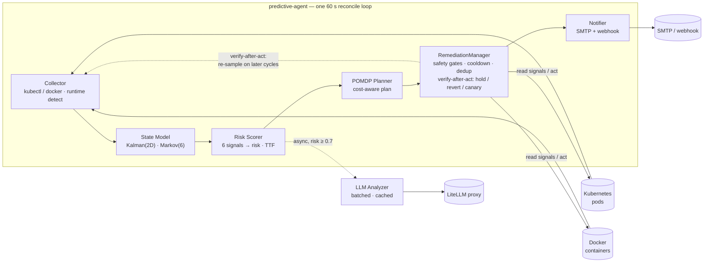

# Predictive Agent

**Predictive health monitor for Kubernetes and Docker — detects failure trends,
predicts crashes, and remediates before they happen.**

It runs a 60-second reconcile loop: it collects pod/container metrics,
estimates resource trends with a Kalman filter, models pod-state transitions
with a Markov chain, scores failure risk from six signals, and — when risk
crosses the threshold — plans and executes remediation through a POMDP-style
decision layer backed by optional LLM analysis. It works **without any LLM** in
pure predictive/planner mode.

- **Dual runtime** — monitors Kubernetes pods (kubectl) *or* Docker containers
  (socket), auto-detected
- **Predictive core** — Kalman(2D) trend estimation, Markov(6) state model,
  Bayesian risk scoring, time-to-failure
- **POMDP decision layer** — cost-aware planning (action cost vs. failure
  risk), what-if simulator, calibration guardrails, monotonic safety gates
- **Closed-loop remediation** — verify-after-act (hold / auto-revert / canary),
  cooldowns, dry-run mode, full audit trail
- **Self-health alerting** — emails its own failure modes (persistence errors,
  degraded-collector streaks), rate-limited per kind
- **Pluggable LLM analysis** (async, batched, cached) — Ollama, Saia, OpenAI;
  predictions carry uncertainty + time-to-failure
- **OPA policy gate (opt-in)** — Rego policy checks gate remediation
- **State persistence** — models and prediction history survive restarts

## Architecture



The loop: **collect → estimate trends → score risk → (if risky) plan with the
POMDP planner → execute with safety checks → verify-after-act → notify →
persist state.**

## Getting started

```bash
# Run the full test suite (hermetic — no cluster, no docker daemon needed)
python -m pytest tests/

# Local spin-up of the decision layer / reconciler against real docker
docker compose up                     # Docker-native mode, dry-run remediation

# Build the reproducible Nix OCI image
./scripts/build-nix-image.sh          # -> predictive-agent:v4.0.8-nix
```

Running modes at a glance:

| Mode | What it monitors | How |
|------|------------------|-----|
| **Kubernetes** | pods via kubectl | `kubectl apply -k k8s/` (kustomize; namespace `openedusuite`) |
| **Docker-native** | containers via socket | `docker compose up` or `docker run` with the socket mounted |
| **Plain package** | same loop, no container | `python -m predictive_agent.main` |

Full build + run instructions (incl. the Docker-native mode, reproducible
chaos/remediation demo, and every image env var) are in
[docs/DEPLOY_NIX.md](docs/DEPLOY_NIX.md).

## Documentation

| Doc | What's in it |
|-----|--------------|
| **Architecture** — [docs/arc42.md](docs/arc42.md) | arc42 template, 12 sections: runtime view, decision layer, deployment view, risks |
| **Operator runbook** — [docs/OPERATOR_RUNBOOK.md](docs/OPERATOR_RUNBOOK.md) | endpoints quick reference, key env knobs, operational scenarios, alert response |
| **Deploy (Nix image)** — [docs/DEPLOY_NIX.md](docs/DEPLOY_NIX.md) | image build, Docker-native + K8s run, env var reference |
| **ADRs** — [docs/adr](docs/adr) | architecture decision records |

## Configuration

100% environment-driven (`predictive_agent/config.py`). Highlights:

```env
# Runtime (auto-detected if unset)
OPERATOR_RUNTIME=kubernetes        # docker | kubernetes
OPERATOR_WATCH_NAMESPACES=default  # k8s namespaces, or compose-project names in docker mode

# LLM (optional; `none` gives pure predictive/planner mode)
LLM_BACKEND=none                   # ollama | saia | openai | none
OLLAMA_URL=http://ollama.llm.svc.cluster.local:11434

# Remediation safety
REMEDIATION_DRY_RUN=true           # SAFE default — set false to actually act
REMEDIATION_RISK_THRESHOLD=0.7
RECONCILE_INTERVAL=60

# Alerting (self-health + remediation notifications)
ALERT_EMAIL_TO=alerts@example.com
SMTP_HOST=smtp.example.com
SMTP_PORT=25
SMTP_USE_TLS=true
```

The full knob list (behaviour, safety, verify-after-act, calibration, cost
model) is in the **Operator runbook §3** and `predictive_agent/config.py`.

## Development

```bash
python -m pip install -e ".[dev]"
ruff check predictive_agent/ tests/ scripts/   # lint
mypy predictive_agent/                          # types
bandit -r predictive_agent -lll                 # SAST (HIGH only)
python -m pytest tests/                         # tests (coverage-gated ≥90%)
```

CI (`.github/workflows/ci.yml`) runs ruff, mypy, bandit, pip-audit, the full
coverage-gated test suite on Python 3.11 + 3.12, and a nightly mutation
campaign.

## License

MIT — see [LICENSE](LICENSE).
