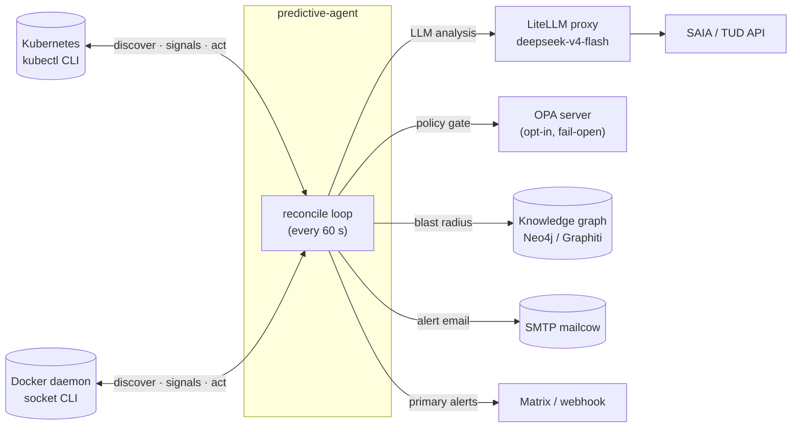
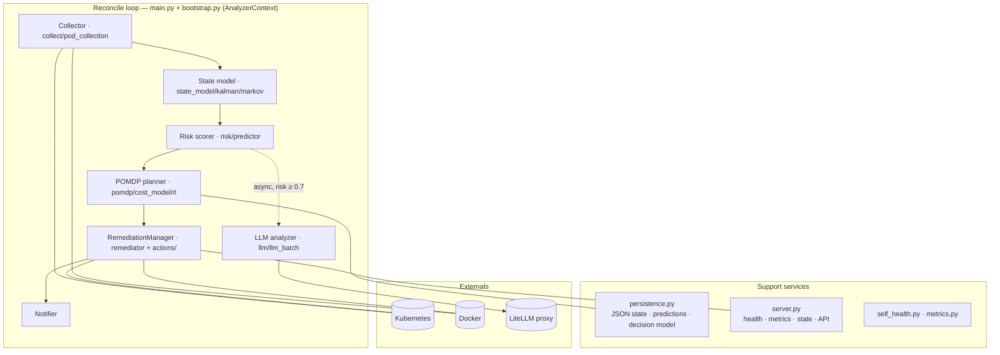
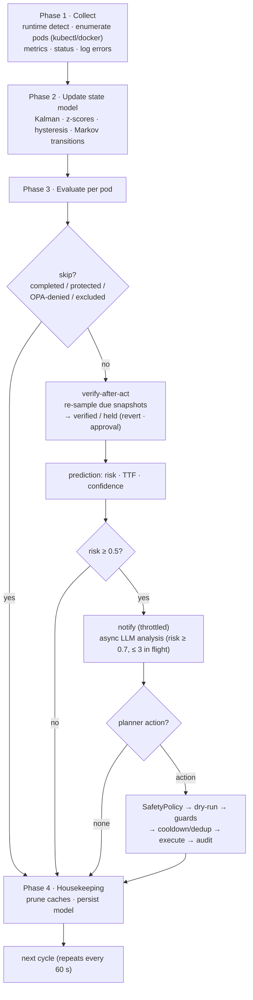
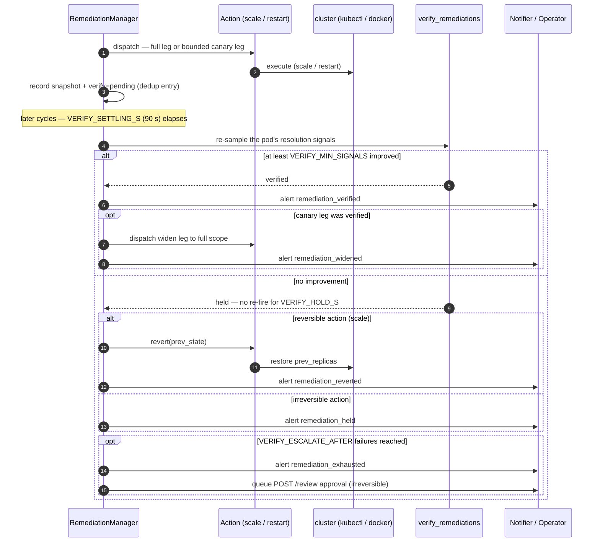

# Predictive Agent — arc42 Architecture Documentation

**Version:** v4.0.8 · **Status:** production · **Updated:** 2026-11-07

This document follows the [arc42](https://arc42.org) template (12 sections). It reflects the
implemented system, including the operational topology and the lessons from the 2026-10/11
"Check LLM connectivity" incident (see §11).

---

## 1. Introduction and Goals

### 1.1 Requirements Overview

The predictive-agent shifts monitoring from *reactive* (crash → alert → analyze) to *predictive*
(observe trends → estimate failure risk → analyze → remediate before impact). It runs on every
host that needs self-healing observability and:

- discovers and watches pods (Kubernetes via `kubectl`) or containers (Docker via the socket),
  honoring label/annotation pod exclusions (KubeVirt `virt-launcher` excluded by default —
  guest-OS memory/CPU must never be auto-remediated),
- every 60 s reconcile cycle: collects metrics, updates per-pod Kalman trend filters and a shared
  Markov state chain, computes a Bayesian failure-risk score (0–1) with time-to-failure (TTF),
- for high-risk pods: runs an asynchronous LLM root-cause analysis (`severity`, `analysis`,
  `action`, `command`),
- plans and conditionally executes remediation through a POMDP-style cost-aware decision layer,
  gated by a SafetyPolicy, cooldowns, dry-run mode, and an OPA policy gate (opt-in, fail-open),
- verifies every executed action against the recorded resolution signals (verify-after-act):
  on failure it holds (no blind re-fire), auto-reverts reversible actions, or requires operator
  approval for irreversible ones; fleet-consequence actions run canary → verify → widen,
- notifies operators via SMTP and/or a Matrix/Alertmanager-compatible webhook,
- persists the Kalman/Markov decision model and prediction history, surviving restarts.

### 1.2 Quality Goals

| Goal | Rationale / measure |
|---|---|
| Availability of the loop | The reconcile loop must survive LLM/OPA/KG outages; every blocking dependency is fail-open or delegated to background threads. |
| Early, *honest* failure signal | Risk score must reflect real degradation; error messages must name the actual fault (see §11 — the entire fleet once produced thousands of mislabeled `Check LLM connectivity` analyses). |
| Safety of autonomous action | Remediation is dry-run by default; actions are gated by risk threshold, cooldown, dedup window, protected namespaces, OPA, a POMDP planner, and a closed verify-after-act loop (hold / auto-revert / canary before widening). |
| Observability | `/healthz`, `/metrics`, `/state`, `/predictions`, `/remediate`, `/reanalyze`, `/remediation-log`, `/remediation/state`, `/review` HTTP endpoints plus structured logs. |
| Cost awareness | The planner weighs action cost vs. expected P(FAILED) reduction; LLM calls are batched/cached and TTL-gated. |

### 1.3 Stakeholders

| Stakeholder | Interest |
|---|---|
| Ops team (single operator, homelab) | Fast, truthful insight into at-risk workloads; no flapping or mislabels. |
| LLM/GPU hosts | The agent must not load shared LLM proxies with implicit unbounded requests. |

---

## 2. Constraints

- **Runtime pairing with orchestrator:** reads Kubernetes via `kubectl` CLI or Docker via the socket;
  auto-detected at startup (`runtime` detection), no in-cluster API client.
- **LLM via LiteLLM proxies:** all production LLM calls go through LiteLLM (`/v1/chat/completions`,
  OpenAI-compatible). The proxy enforces model routing and (on some hosts) authentication.
- **Deployment:** Docker Compose (see `docker-compose.yml`) for Docker-native hosts, or kustomized
  Kubernetes manifests (`k8s/`); a Nix-built OCI image (`nix/predictive-agent.nix`).
  Per-host config via env; secrets via environment variables / vault.
- **Environment-driven configuration:** every tunable is an env var (`config.py`); no config files.
- **Host network caveats:** on a bridge network the agent reaches host services via the docker
  gateway `172.31.0.1`; on host networking it reaches them at `127.0.0.1`.

---

## 3. Context and Scope

### 3.1 Business Context

Single-operator self-hosted infrastructure. The agent is
one node in a supervision stack: Prometheus/Grafana/Loki for classic metrics, Matrix for alert
transport, a Neo4j knowledge graph for dependency/blast-radius, OPA for policy — and this agent for
*failure prediction and autonomous remediation*.

### 3.2 Technical Context (external systems)

| System | Protocol | Used for | Failure handling |
|---|---|---|---|
| Kubernetes cluster(s) | `kubectl` | pod discovery, status, logs, `top` | skip pod on error |
| Docker daemon (socket) | `docker` CLI | container discovery, inspect, stats, logs | skip on error |
| LiteLLM proxy | OpenAI `/v1/chat/completions` | LLM analysis backend (`local/deepseek-v4-flash/local`) | honest per-class fallback (§11) |
| SAIA / TUD APIs | OpenAI-compatible | alternate LLM backends | backend switch per env |
| OPA server (opt-in) | REST/Rego | pod-security + LLM-usage gates | fail-open |
| Knowledge graph (Graphiti/Neo4j) | REST/MCP | blast radius for risk scoring | 0 (disabled) on error |
| SMTP mailcow (example.org) | SMTP :587 STARTTLS | alert email | logged; webhook still delivers |
| Matrix / webhook bridge | HTTP POST | primary alert channel | logged |
| Zot registry | HTTPS registry API | image distribution at deploy time | n/a |



---

## 4. Solution Strategy

A **single-process, single-loop operator**: everything needed for one reconcile cycle is owned by an
`AnalyzerContext` (built in `bootstrap.py`) holding the collectors, state model, predictor, risk
scorer, remediation manager, notifier, policy engine, KG client and LLM analyzer. The main loop in
`main.py` runs the four reconcile phases every `RECONCILE_INTERVAL` (default 60 s) and blocks on no
external dependency:

- **Predictive core:** Kalman (level+velocity) per pod for memory/CPU trends + anomaly z-scores;
  a *shared* 6-state Markov chain learns POD-level transition probabilities; `classify_state`
  maps metrics → HEALTHY/DEGRADED/STRESSED/CRITICAL with hysteresis (debounced state commits).
- **Risk = Bayesian update** over a base rate (`PREDICTION_BASE_RISK`), multiplying likelihood
  ratios for memory%, memory TTF, cpu%, cpu trend, restart rate, log-error rate, node pressure,
  markov state + P(critical/failed), anomaly scores, blast radius, and pod-phase/container-status
  signals; capped at 0.99.
- **Decision layer:** POMDP-style planner (`pomdp.py`) selects the intervention sequence
  minimizing expected P(FAILED) given action cost; every step is re-gated by SafetyPolicy.
- **Analysis:** LLM analysis runs *in a background thread* (never blocks the loop), is
  TTL/dedup-gated per pod (`LLM_ANALYSIS_TTL`), capped concurrent (`MAX_PODS_PER_CYCLE`), and its
  output is stored per pod.
- **Safety:** dry-run default, risk threshold, cooldowns, dedup window, protected namespaces,
  OPA fail-open, full audit trail, and a closed loop: post-action verification against recorded
  resolution signals, hold (never re-fire a failed action), auto-revert of reversible actions,
  operator approval for irreversible ones, and canary → verify → widen for fleet-consequence
  actions.

---

## 5. Building Block View

### 5.1 Level 1 — System decomposition (`predictive_agent/`)

```
main.py ────────── entrypoint: parse args, build context (bootstrap), run reconcile loop
bootstrap.py ───── AnalyzerContext wiring: collectors, state model, scorer, planner, notifier,
                   OPA, KG, LLM analyzer; runtime (k8s/docker) detection
reconcile_phases.py — the 4 reconcile phases (see §6)
  collector.py     runtime discovery + metric/status/log collection (k8s `kubectl`, docker)
  pod_collection.py helpers (memory limits, docker selectors, restart counts)
  state_model.py   PodTracker: Kalman filters, % calc, classify_state with hysteresis; StateModel
  kalman.py        KalmanTrend (level+velocity) + anomaly z-score
  markov.py        MarkovChain (6 states, transitions learned from observed state changes)
  risk.py          calculate_risk(): Bayesian likelihood-ratio scoring → risk, (TTF in tracker)
  predictor.py     per-pod prediction record assembly (risk, markov state, TTF, confidence)
  pomdp.py         POMDP-style remediation planner
  remediator.py    RemediationManager: SafetyPolicy, cooldowns, dedup, protected namespaces,
                   audit trail, manual trigger; closed-loop verify-after-act: action snapshots →
                   verification → hold / revert / canary-widen (see §6 “Closed loop”)
  actions/         remediation action implementations (e.g. container_restart for docker)
  cost_model.py, calibration.py, rl.py  planner support (costs, calibration, RL/Q-table)
  llm.py           LLMAnalyzer: prompt build, (now deterministic) OpenAI-compatible call with
                   bounded max_tokens, JSON-tolerant parse, honest error classification
  llm_batch.py     batched/parallel analysis processor
  notifier.py      SMTP (example.org relay) + webhook notification manager
  self_health.py   self-health alerting: persistence / collector-failure mails, watchdog parity
  metrics.py       Prometheus-exposition counters & timers (calls, errors, decision metrics)
  server.py        metrics/health/state/API HTTP server (ThreadingHTTPServer)
  persistence.py   state-model, predictions, decision model (POMDP), Q-table persistence
  backtester.py    offline backtest/replay engine for calibrating risk thresholds
  kg_integration.py, opa_client.py, opa_integration.py, opa_cache.py, l1_cache.py  optional
                   integrations (KG blast radius, OPA gate, caches; all fail-open)
  coordinator.py, shadow.py, benchmark.py, demo_optimizations.py, optimize.py  eval/coordination
```

Data flow between the levels (building blocks → support services → externals):



### 5.2 Level 2 — Reconcile context

`AnalyzerContext` (bootstrap) exposes the collaborating objects to the phases: collectors,
`StateModel` (with `markov`), `Predictor`, risk scorer, `RemediationManager`, `Notifier`,
policy engine, KG client, LLM analyzer, per-host config, watch selectors, `_llm_in_flight` set,
`_llm_analysis_cache` map, and conversation/notify throttles.

### 5.3 Level 3 — LLM analyzer (hardened error taxonomy)

`LLMAnalyzer.analyze(issue, context, prediction)`:
1. `build_prompt` appends *"Respond with ONLY a JSON object … `analysis, severity, action, command`.
   No markdown, no prose outside the JSON."*
2. Sends `POST {url}/chat/completions` with `{"model", "messages", "max_tokens": 4096}` (+
   `Bearer` key when configured). `max_tokens` is **mandatory**: without it LiteLLM requests the
   model's full output budget (204 800) → `ContextWindowExceededError` → HTTP 400 on every call
   (the fleet-wide incident root cause, §11).
3. `parse_response` strips code fences and prose and extracts the first balanced JSON object —
   required because reasoning models (DeepSeek V4 Flash) emit `reasoning_content` and may wrap JSON.
4. Failure classification is now *honest*:
   - HTTP 4xx ⇒ `action: Fix LLM request (HTTP n)` (config/request problem)
   - `TimeoutError` ⇒ `action: Retry, LLM timed out` (≠ connectivity)
   - `URLError`/`OSError` ⇒ `action: Check LLM connectivity` (only real connectivity loss)
   - anything else ⇒ `action: Monitor, analysis deferred`

   Requests run with a generous 300 s timeout (background thread) so reasoning models under
   JIT/load (e.g. direct vLLM/DSpark) do not trip on tight deadlines.

---

## 6. Runtime View — one reconcile cycle



Phase 1 **Collect** (`reconcile_phases.py`): detect runtime; enumerate pods (kubectl/docker);
collect metrics (top/stats), status signals, log-error counts; degraded-mode fallback when
collection fails (uses last known tracker values, phase `Unknown`).

Phase 2 **Update state model**: for each pod call `state_model.update_pod(...)` — Kalman update,
anomaly z-scores, `memory_pct`/`cpu_pct`, debounced re-classification, Markov transition recording
on state change.

Phase 3 **Evaluate per pod**:
- skip completed Jobs/Succeeded pods, protected namespaces, OPA-denied pods, and pods excluded
  by `PREDICTIVE_AGENT_EXCLUDED_POD_LABELS` / `PREDICTIVE_AGENT_EXCLUDED_POD_ANNOTATIONS`
  (KubeVirt `virt-launcher` by default — honored in both the collect phase *and* the per-pod
  evaluation loop),
- compute prediction (risk, TTF, confidence, markov state + P(critical/failed)),
- store `pod_metrics` + prediction (persisted),
- if `risk ≥ PREDICTION_RISK_THRESHOLD`: warn log, notify (throttled) and **spawn LLM analysis**
  (background thread, gated by `LLM_ANALYSIS_THRESHOLD`=0.7, per-pod TTL 300 s, ≤3 in flight),
- remediation planning/execution if `REMEDIATION_ENABLED`/`PLANNING_ENABLED` (planner → SafetyPolicy
  → dry-run check → per-action guard → cooldown/dedup → execute → audit → verify, closing the loop
  in the same or a later cycle — see below).

Phase 4 **Housekeeping / finalize**: clean up removed pods, prune cache entries, persist model.

`/remediate` (POST) and `/reanalyze` (POST) allow manual operator override.

### Closed loop: act → verify → hold/revert/widen (verify-after-act)

Every executed action records a signal snapshot (state, memory/cpu %, restart count,
log errors, node pressure) in its idempotency entry. On a later reconcile for the same pod,
`evaluate()` (and the `plan_and_execute` planner path) verifies due entries (after
`VERIFY_SETTLING_S`): at least `VERIFY_MIN_SIGNALS`
resolution signals must show sustained improvement, else the key is **held** for
`VERIFY_HOLD_S` (no blind re-fire). Repeated failures feed the existing futile channel
(`note_remediation_outcome` → `remediation_exhausted`). Reversible actions (`reversible: true`,
currently `scale`) auto-revert via `revert(target, prev_state)`; irreversible ones require an
operator `POST /review` approval before another attempt. Canary-capable actions
(`canary_fraction > 0`, currently `scale`) execute a bounded first leg (`.../canary` key),
verify it, then widen (`.../widen` key) — each leg dedups and verifies independently. State is
surfaced at `GET /remediation/state`; per-row `lifecycle` on `GET /remediation-log`; alerts
`remediation_verified/held/reverted/widened/canary/exhausted` flow to the notifier
(throttled per target + kind). See `docs/BEST_PRACTICES_AUDIT.md`.

Sequence view of one action's lifetime:



---

## 7. Deployment View

- **Image:** `registry.example.com:5001/predictive-agent:v4.0.8-nix` (OCI), built from
  `nix/predictive-agent.nix` or the repo `Dockerfile` (python 3.12 + `kubectl` + `docker` CLI;
  healthcheck uses `urllib`, no curl).
- **Run modes:** Kubernetes (kustomized manifests in `k8s/`, namespace `openedusuite`) or
  Docker-native (`docker compose up`, socket mounted read-only).
- **Topology (production):** the agent runs one container per host, on either a bridge network
  (Docker-native; reaches host services via the gateway `172.31.0.1`) or host networking.
  It watches the configured namespaces/compose projects, calls LiteLLM for analysis, and sends
  alerts via SMTP relay + webhook.
- **Environment:** every tunable is an env var (LLM backend/endpoints, watch namespaces,
  reconcile/risk/analysis TTLs, remediation flags, SMTP relay + recipients, webhook URL,
  metrics/health ports, resource limits, TZ). See `predictive_agent/config.py` and the
  operator runbook §3.
- **LLM route:** agent → LiteLLM (`/v1/chat/completions`) → model (`local/deepseek-v4-flash/local`
  by default). Optional; `LLM_BACKEND=none` runs pure predictive/planner mode.
- **Data:** persistent volume `/var/lib/opendesk/*.json` (state model, predictions, decision model,
  Q-table); `restart: unless-stopped`; healthcheck on `/healthz` every 30 s.

---

## 8. Cross-cutting Concepts

- **Configuration:** 100% env-driven (`config.py`); defaults sane for dev; deployment overrides in
  ansible. Version pinned via `Dockerfile OPERATOR_VERSION` + `pyproject.toml`.
- **Persistence:** JSON files only (Kalman/Markov/POMDP/Q-table/predictions); no external DB.
- **Concurrency:** reconcile loop is single-threaded; LLM analysis spawned per pod (bounded);
  HTTP server on its own thread; shared state protected by a small lock set.
- **Failure isolation:** every integration is wrapped; failures are logged and the loop continues
  (fail-open philosophy documented in ADR-0001 for the decision layer).
- **Observability:** structured logging (`severity` levels via `LOG_VERBOSITY`), `/metrics` counters
  (calls/errors/timing), `/healthz`, `/state`, `/predictions`, `/remediation-log`,
  `/remediation/state`; closed-loop outcome alerts `remediation_verified/held/reverted/widened/
  canary/exhausted` flow through the notifier (throttled per target + kind).
- **Security:** secrets only via env/vault; OPA gates (opt-in); protected namespaces; dry-run
  remediation; no credentials in logs.
- **Closed loop (verify-after-act):** every executed action records a signal snapshot and is
  re-sampled after `VERIFY_SETTLING_S`; it must show ≥ `VERIFY_MIN_SIGNALS` improving resolution
  signals to count as `verified`. Failures hold (`VERIFY_HOLD_S`), auto-revert `reversible`
  actions, gate fleet changes behind canary, escalate via `remediation_exhausted`, and are fully
  observable (`GET /remediation/state`, per-row `lifecycle` on `/remediation-log`).

---

## 9. Architecture Decisions

- ADR-0001 — `docs/adr/0001-pomdp-decision-layer.md`: POMDP as decision layer.
- **Verify-after-act closed loop (2026-11)** — decision recorded in
  `docs/BEST_PRACTICES_AUDIT.md` (recommendations 1–3) and shipped via the OpenSpec change
  `verify-after-act-reversible-remediation`: post-action verification, hold, reversibility with
  auto-revert, canary widening. (A dedicated ADR is still to be written.)
- *Planned ADRs (fixes already shipped v4.0.5–v4.0.8, decisions not yet formally recorded):*
  mandatory bounded `max_tokens=4096`, honest LLM error taxonomy, docker `RestartCount` top-level
  read, alert delivery via the example.org relay, KubeVirt `virt-launcher` exclusion default.

---

## 10. Quality Requirements

### 10.1 Quality tree

- **Correctness of signal** — risk must reflect real state; no mislabeled fallbacks.
- **Availability of the loop** — no single external dependency may stop reconcile.
- **Safety of remediation** — dry-run default, multi-gate approval, audit trail, and closed-loop
  verify-after-act (hold / revert / canary before any blind repeat).
- **Operability** — zero-config per host beyond env; health/state endpoints; restart survival.

### 10.2 Scenarios

- *KS-1 LLM proxy returns 400 for every request:* the agent must surface the HTTP code (not
  "connectivity"); analysis must still be attempted periodically.
- *KS-2 GPU host reboots (vLLM down):* analyses must not block the loop; action
  `Retry, LLM timed out`/`Check LLM connectivity` with the real error surfaced.
- *KS-3 Docker daemon flaps:* kubectl/docker collect failures degrade gracefully to last-known
  state (`degraded mode`).
- *KS-4 Crash-looping container:* must be flagged at high risk *with correct restart counts* (see
  §11 known defect) and produce a real LLM analysis.
- *KS-5 Action executed but no measurable improvement:* after `VERIFY_SETTLING_S` the action is
  **held** (no re-fire) and — if reversible (`scale`) — auto-reverted; operators see
  `remediation_held`/`remediation_reverted` and a `held` lifecycle row; an irreversible action
  additionally queues a `POST /review` approval item.
- *KS-6 Fleet-consequence action (canary):* `scale` runs a bounded first leg, waits for its
  verification, and only then widens — a failed canary leg aborts the widen and follows the
  hold/escalate path (`remediation_canary` → `remediation_held` alerts).

---

## 11. Technical Risks and Known Issues

| # | Risk / known issue | Status 2026-11-07 | Mitigation / work |
|---|---|---|---|
| 1 | **LLM analysis always failed (incident)**: LiteLLM requests full output budget when `max_tokens` omitted → HTTP 400 → generic fallback **mislabeled** `Check LLM connectivity`. 7 625+ identical entries fleet-wide. | FIXED in v4.0.5–v4.0.7 (bounded `max_tokens=4096`, honest error taxonomy, JSON-tolerant parse, timeout 300 s). | Monitored via log wording + `/metrics`. |
| 2 | **Hub-gateway reachability:** agent on bridge net can't reach `127.0.0.1:4000` (connection refused). | FIXED (dockered hosts use `172.31.0.1:4000`). | Host vars + env template; documented in ansible commit. |
| 3 | **Docker restart signal lost** — `get_container_status_signals` read `State.RestartCount`, but docker inspect exposes `RestartCount` at the container **top level**; result: docker pods always reported `restarts=0` even while crash-looping. | FIXED in v4.0.8 (top-level read + new `docker_status_signals()` in collector.py). | Verified live: a deliberately crash-looping container scores 0.80 with a real restart-aware LLM analysis. |
| 4 | **Failure detail invisible in logs** — on LLM-analysis fallback, logs printed only `severity/action`; the root-cause text (in `analysis`) and the inner exception (DEBUG) were dropped. | FIXED in v4.0.8 (`LLMAnalyzer` logs every fallback at WARNING with the underlying cause). | Bounded by per-pod TTL (300 s), so a sick LLM shows a bounded warning stream, not silence. |
| 5 | **Stale duplicate socat containers** (`fwd-gpu-node*`) crash-looped on bound ports; agent correctly scored them DEGRADED. | FIXED operationally (containers removed; systemd units are the live forwarders). | Watch for similar `bind(): Address in use` restart storms. |
| 6 | **SMTP relay** — directly reaching the relay `smtp.example.com:25` was rejected from residential IPs. | FIXED (mail relay via `alerts@example.org`). | Env-driven; no hardcoded relay/account in the repo. |
| 7 | 0.5 (atten risk) vs 0.7 (LLM analysis) threshold gap: pods scoring 0.5–0.7 count as at-risk but get no analysis. | By design. | Document; consider aligning thresholds if analysis cost allows. |
| 8 | Registry/CI drift: image tag lives in ansible role default; must be bumped together with `pyproject.toml`/`Dockerfile`. | Manual, documented. | CI pipeline could automate tag propagation. |
| 9 | **Docker CLI dropped from image** (commit `52af6dd`) — the kubectl-only rewrite assumed docker-mode didn't need the client; the dockered agent silently went to `0 pods tracked` with no warnings on the first build after it (v4.0.8, caught same-day). | FIXED (v4.0.8 rebuild fetches static docker CLI 29.9.1 via urllib, sha-pinned like kubectl). | Lesson: any Dockerfile change must keep BOTH runtime CLIs; verify both `docker` and `kubectl` work in the built image. |
| 10 | **Verification false-fail:** a *helpful* action whose benefit isn't captured by the six resolution signals is wrongly held (`VERIFY_MIN_SIGNALS` unmet) until the hold expires. | By design, conservative — never a blind pass. | Set `resolution_signals` per action to the signals it actually moves; unblock early via `POST /review` approval (clears the hold); watch the `remediation_held` false-positive rate in `/remediation/state`. |

---

## 12. Glossary

| Term | Meaning |
|---|---|
| Reconcile cycle | One full run of phases 1–4 (default every 60 s). |
| Kalman trend | 2D filter (level + velocity) producing trend + anomaly z-score per metric. |
| Markov state | One of HEALTHY → DEGRADED → STRESSED → CRITICAL → FAILED → RECOVERED. |
| Risk score | Bayesian posterior (0–1) over base rate with signal likelihood ratios. |
| TTF | Estimated minutes to a failure threshold (memory-based). |
| POMDP record | Planner action recommendation (what/when) minimizing expected P(FAILED). |
| `_llm_in_flight` | Set of pod keys whose analysis thread is currently running (bounded). |
| Verify-after-act | Post-action re-sampling of ≥ `VERIFY_MIN_SIGNALS` resolution signals after
  `VERIFY_SETTLING_S`; marks an execution `verified` or `held`. |
| Hold | State in which a failed-verification action is blocked from re-firing for `VERIFY_HOLD_S`;
  re-arms as a fresh retry after expiry or operator approval. |
| Reversibility | Declared undo (`reversible: true` + `revert(target, prev_state)`); `scale` restores
  the recorded `prev_replicas` when verification fails. |
| Canary leg / widen | Two-phase execution of a fleet-consequence action: a bounded `…/canary` leg
  first, then — only after it verifies — the `…/widen` leg to full scope. |
| `remediation_exhausted` | Escalation alert (existing futile-remediation channel) raised after
  `VERIFY_ESCALATE_AFTER` consecutive failed verifications or futile cycles. |
| FAIL-open | On integration failure: allow and continue rather than block the loop. |
